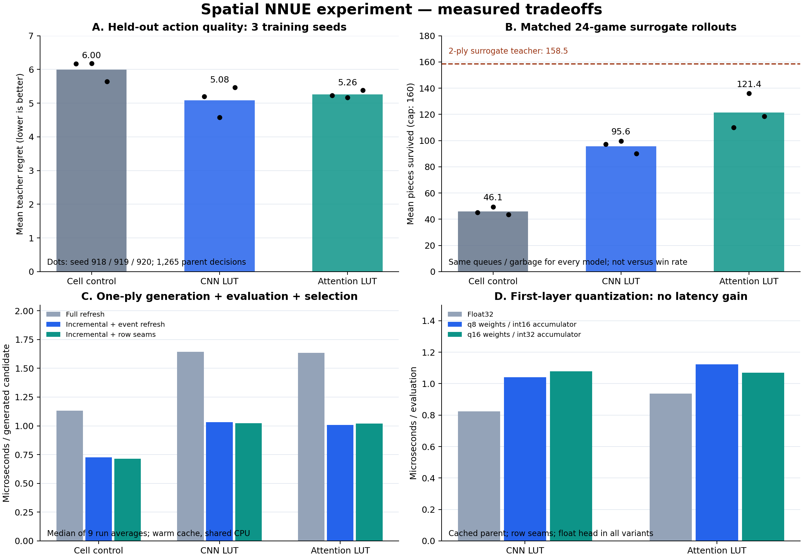

# Spatial NNUE: whole-row events, compiled CNNs and additive attention

This is an executed research experiment for `muse918/cold-clear-nnue`, based on
commit `31713b0bd20c0bddf9dfa11daacdbd2d67888ae4`. It contains training, native
evaluation, quantization, row-transition differential checks and a one-ply
search-expansion benchmark. Measurements were made on 2026-11-11.

**Decision:** carry forward the **3×4 local CNN compiled to a 4,096-entry LUT,
with two fixed-query attention heads, a small absolute-position branch, and
float32 accumulators**. Use sparse updates for ordinary locks. Keep full refresh
as the default rare-event path; the independently verified row-seam path remains
available for event-heavy workloads. Retain the simpler CNN-pooling model as an
ablation and a lower-cost evaluator. First-layer-only q8/q16 is not the default:
it reduced parameter payload but increased incremental latency in this implementation.

The decision selects a research architecture, not a finished TETR.IO battle bot.
The new `cell` model is a controlled baseline; it is **not** the repository's
existing position-specific categorical NNUE. Existing Rust models/checkpoints
were not run. The supplied official `tetrio.js` is an external verification input
and is not redistributed.

## Results

### Quality on separate held-out games

All local models were trained with the same 14-epoch budget at seeds 918, 919 and
920. Train/validation/test separation is by paired game IDs, preserving clean and
garbage conditions in each split. The final heldout file has 29,346 candidates
from 16 additional games and 1,265 lock decisions.

| Model | Heldout RMSE, 3-seed mean | Teacher action agreement | Teacher regret, mean | Mean pieces survived, 24 matched games × 3 models | Reached the 160-piece cap |
|---|---:|---:|---:|---:|---:|
| Cell control | 23.825 | 54.36% | 5.995 | 46.07 | 0% |
| CNN LUT, sum pooling | 21.039 | 59.76% | **5.079** | 95.64 | 5.56% |
| CNN LUT, fixed-query attention | **20.324** | **60.69%** | 5.257 | **121.39** | **29.17%** |

The attention model survives longer than the CNN-pooling model in each of the
three training seeds; per-seed means are 109.88/135.92/118.38 versus
97.17/99.63/90.13 pieces. CNN pooling has slightly better average teacher regret.
Thus a single scalar fitting metric would not give the same ranking as closed-loop
behavior. Three seeds are a small experiment, not a confidence interval or a
general superiority claim.

Two reference models were trained only at seed918: a two-layer spatial CNN
survived 111.58 pieces on average, and a one-block row Transformer 50.08. The
explicit two-ply surrogate teacher survived 158.54 and reached the cap in 23/24
games. The learned models still have a substantial closed-loop quality gap.

These are capped solo hard-drop surrogate games. They have no hold, kicks, spins,
attack/cancellation, opponent, input timing, or full official topout behavior.
They are not TETR.IO win rates. Rollout garbage is an independent fixed schedule,
including situations outside the generator's low-stack garbage policy.

### One-ply search expansion

Final seed918, 1,265 roots / 29,297 generated candidates, median of **nine run
averages**, microseconds per candidate. The benchmark includes move generation,
lock and clear board transitions, evaluator updates and head, current reward,
and argmax. It excludes teacher continuation labels, deeper search and battle rules.

| Model | Full refresh | Ordinary increment + event refresh | Ordinary increment + row seams |
|---|---:|---:|---:|
| Cell control | 1.132 | 0.728 | 0.715 |
| CNN LUT | 1.645 | 1.032 | 1.023 |
| Fixed-query attention LUT | 1.633 | 1.008 | 1.019 |

Sparse ordinary-lock updates deliver approximately **1.6×** throughput in this
one-ply workload. Small cross-model/path differences overlap shared-host timing
variation. These numbers are not an estimate of a complete bot's nodes per second.

Clears occur in **2.25% of generated training candidates**, but **30.73% of
selected trajectory moves**. The rare-event assumption is appropriate for this
candidate stream, not a universal property of played Tetris moves. Row-seam
reuse reduces measured single-clear/garbage evaluation cost, but its extra total
benefit is within run variation in this workload. It should remain a measured
option rather than an assumed source of a large throughput gain.

### Quantization result

Cached-parent evaluator timing, row-seam path, microseconds per candidate:

| Model | Float32 | q8 weights / int16 accumulator | q16 weights / int32 accumulator |
|---|---:|---:|---:|
| CNN LUT | **0.824** | 1.041 | 1.078 |
| Attention LUT | **0.936** | 1.122 | 1.069 |

Only the additive first layer/LUT was quantized. The head, dequantization,
attention division and score remain float. All integer updates are bit-exact
relative to the corresponding quantized refresh, with proved all-board bounds;
this does not mean q8 scores equal float scores. For CNN, q8 changes about
1.1–1.8% of heldout best choices across seeds, while q16 preserves all choices.
The quantized parameter payload is smaller, but the verification harness also
retains the float master, so payload bytes are not measured process RSS.



## What was verified

- **129,837 transitions** against isolated row primitives extracted from the
  supplied official client: 98,091 train, 29,346 heldout, 2,400 adversarial.
- Whole-row stable compaction, row-source mappings, ordinary garbage insertion,
  clear-then-garbage order, and fixed-orientation drop footprints.
- All 4,096 possible local binary patterns against an independent Conv2d
  calculation and the native encoder/LUT calculation.
- Float refresh/update equivalence with documented tolerances; carried selected
  paths up to 88 transitions; all adversarial boundary checks.
- All 18 local-model/seed/integer-precision combinations with bit-exact
  integer refresh/update equivalence and conservative accumulator bounds.
- Regenerated children/order and identical chosen actions for all three update
  paths at every heldout root in the search-expansion benchmark.

This scope does not establish full SRS+ reachability, spin classification,
attack/cancellation, observation timing, live client behavior or match strength.
The pinned Triangle wrapper also has an occupied-buffer garbage truncation
counterexample and incomplete battle-state messages; see the audit before
building the production adapter.

## Files

| File | Purpose |
|---|---|
| [REPORT.ko.md](REPORT.ko.md) | Detailed Korean reasoning, results and integration decisions |
| [ARCHITECTURE.md](ARCHITECTURE.md) | Exact feature/accumulator mathematics and model format |
| [QUANTIZATION.md](QUANTIZATION.md) | Integer ranges, parity, sensitivity and timing |
| [rules/RULES_AUDIT.md](rules/RULES_AUDIT.md) | Official client and pinned Triangle audit |
| [rules/PEER_REVIEW.md](rules/PEER_REVIEW.md) | Independent review and validation scope |
| [legacy-parity/README.md](legacy-parity/README.md) | Isolated reproductions of existing SIMD discrepancies |
| [generate.cpp](generate.cpp) | Deterministic hard-drop dataset and shared move-generator ABI |
| [train.py](train.py), [evaluate.py](evaluate.py) | Training, export, independent ranking and matched rollouts |
| [kernels.cpp](kernels.cpp) | Native float evaluator and all three update strategies |
| [quantized.cpp](quantized.cpp) | q8/q16 first-layer experiment |
| [search_bench.cpp](search_bench.cpp) | Generation-inclusive one-ply benchmark |
| [stress.py](stress.py) | Adversarial row/buffer/combined-event records |
| [summarize.py](summarize.py) | Aggregates saved results and draws the figure |
| [results/final/summary.json](results/final/summary.json) | Machine-readable final decision and aggregates |
| [results/final/environment.json](results/final/environment.json) | Versions, hardware, dataset hashes and timing conditions |

All final checkpoints (`.pt`), compiled native model files (`.snn`), encoder
source weights and measured JSON reports are included. Seed918 is the fixed
representative checkpoint for native timing, not a winner selected on heldout
or rollout results. Raw datasets, compiled executables/shared libraries, scratch
logs, intermediate predictions and pilot runs are excluded and reproducible.

## Reproduce

The measured environment used GCC 14.2, Python 3.12, NumPy 2.3.5, PyTorch
2.15.0+cpu, Matplotlib 3.10.8 and an AMD EPYC 9V74. Native programs use C++17 and
have no Torch dependency. The official oracle needs a Node version with
`node:module.stripTypeScriptTypes` (the recorded checks used the supplied Node
runtime). Timing was serial, warm-cache, without CPU/clock pinning; min/max
and individual search-run samples are retained.

From this directory:

```bash
python3 -m pip install numpy==2.3.5 matplotlib==3.10.8
python3 -m pip install torch==2.15.0+cpu --index-url https://download.pytorch.org/whl/cpu
make all
make data
make evaluate
make report
```

`make evaluate` uses the included checkpoints, checks native-vs-Torch output,
and reruns all three seeds' local-model rollouts plus the seed918 reference
models and surrogate teacher. To repeat training first:

```bash
make train
make evaluate
```

For official differential checks, supply the exact audited external file:

```bash
make verify TETRIO_JS=/absolute/path/to/tetrio.js
```

The client hash must be
`6b682a1226dd2ae66ce19a08e944df92e7f175bccaa48cca7269bcd78f39a27a`.
The oracle deliberately rejects a different build until its extraction points
and behavior are re-audited. Without that external file, native correctness,
training and benchmarks can still be run individually; the saved official
results remain evidence for the pinned client only.

After training/evaluation has finished and no other CPU workloads are running:

```bash
make benchmark
make report
```

`make benchmark` intentionally runs serially. `-march=native` produces binaries
for the build machine. Changing hardware/compiler or running concurrent work
can change the timing rankings; compare the raw ranges, not just rounded medians.
The generator and `libmoves.so` deliberately use separate `DATA_CXXFLAGS`
(`-O3 -std=c++17`, without `-march=native`) to match the recorded dataset hashes.
Changing floating-point contraction/compiler behavior can change teacher labels;
the published hashes are tied to the recorded toolchain.

## References

- [Stockfish NNUE documentation](https://official-stockfish.github.io/docs/nnue-pytorch-wiki/docs/nnue.html): sparse additive feature transforms, accumulator updates and quantization.
- [PyTorch Conv2d](https://docs.pytorch.org/docs/main/generated/torch.nn.Conv2d.html): the convolutional reference operation used in the exhaustive check.
- [Set Transformer, Lee et al. 2019](https://proceedings.mlr.press/v97/lee19d.html): attention pooling background; the implemented model is a restricted local fixed-query construction, not the complete paper architecture.
- [Transformers are RNNs, Katharopoulos et al. 2020](https://proceedings.mlr.press/v119/katharopoulos20a.html): additive summaries for linear attention; discussed as a possible extension, not implemented here.
- [Attention Is All You Need](https://arxiv.org/abs/1706.03762): full content-dependent self-attention reference.
- [Pinned Triangle source](https://github.com/halp1/triangle/tree/aa0698ab8b4299b85c5f87e9b54793e1b7d9d380): wrapper and engine audit.
