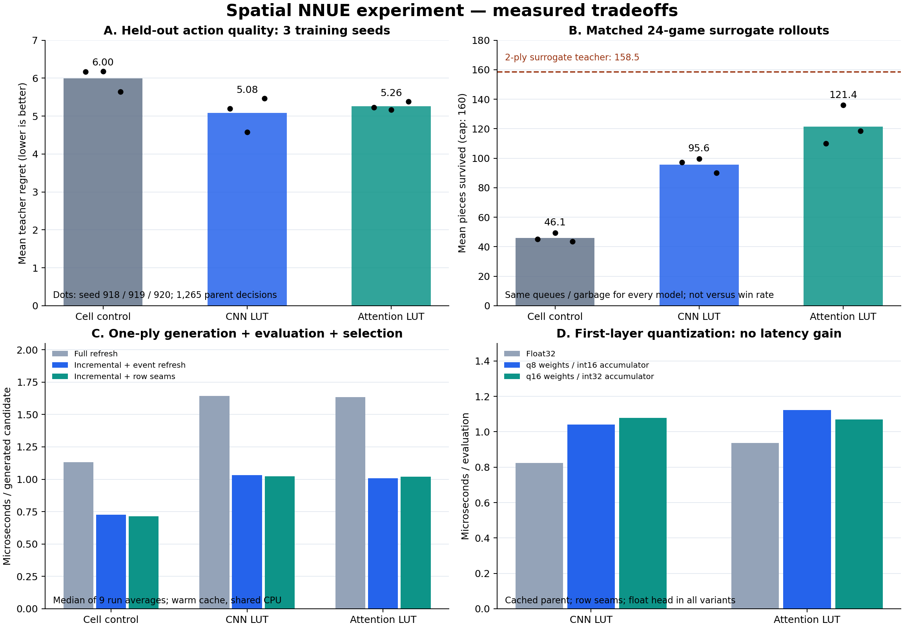

# TETR.IO용 Spatial NNUE 구조 실험과 결정

작성일: 2026-11-11. 기준 저장소: `muse918/cold-clear-nnue`,
`31713b0bd20c0bddf9dfa11daacdbd2d67888ae4`.

## 1. 결정

다음 단계의 기본 평가기로 **3×4 지역 CNN을 LUT로 컴파일하고, 고정 query
attention의 분자·분모를 증분 누적하는 구조**를 선택한다. 작은 절대 위치
branch를 함께 두고, 현재 구현의 추론 정밀도는 **float32**로 유지한다.

| 항목 | 결정 | 실제 근거 |
|---|---|---|
| 지역 특징 | 12-bit 패턴 → 4,096-entry shared LUT | 모든 패턴에서 원본 CNN 계산과 일치 확인 |
| 전역 집계 | x 위치별 고정 query 2개, head당 value 8차원 | 세 학습 시드 모두 단순 CNN pooling보다 긴 surrogate 생존 |
| 일반 lock | 바뀐 4셀 주변의 patch와 위치 accumulator만 갱신 | 생성 포함 1-ply 확장에서 전체 refresh 대비 약 1.6배 |
| clear/garbage 기본 경로 | 전체 refresh | 후보 중 clear 약 2.3%; seam의 전체 추가 이득은 변동 범위 안 |
| 행 재사용 | 검증된 선택 경로로 보유 | clear/garbage 개별 비용 감소, 비연속 삭제·복합 사건까지 검증 |
| q8/q16 | 기본 경로에서 제외, 정수 기준 구현으로 보유 | 이 구현에서는 float보다 증분 평가가 느림 |
| 대표 checkpoint | seed918 유지 | heldout/rollout에서 가장 좋은 seed를 골라 보고하지 않음 |
| 일반 Transformer | 현 탐색 평가기의 기본 구조에서 제외 | 이번 학습 예산에서 이점 미확인; 깊은 self-attention의 전역 의존성 |

이는 **구조 연구의 결정**이다. 포함된 학습 가중치는 단순 teacher를 모방한
실험용이고, 완전한 대전 규칙·탐색·입력 실행까지 연결한 봇은 아니다. 기존
Rust의 실제 학습 checkpoint가 저장소에 포함되어 있지 않고 Rust 도구체인이
없어, 기존 봇과의 대전 성능 및 전체 Rust 빌드는 측정하지 않았다.

## 2. 기존 레포에서 바뀌어야 하는 관점

기존 `bot/src/evaluation/nnue.rs`도 이미 3×4 패턴과 10×1 행 패턴을 사용한다.
따라서 지역 패턴을 도입한다는 것 자체가 새 제안은 아니다. 핵심 차이는
**패턴과 절대 위치를 분리하고, 지역 encoder를 공유하며, 부모의 합계를
검색 노드에 보관하는 것**이다.

기존 40행 버전은 `(위치, 패턴)`마다 별도 128차원 가중치를 갖는다.
`ENCODE_LEN × 128 × sizeof(float)`만 계산해도 첫 층 weight가
641,764,352바이트, 약 612 MiB이다. 이것은 소스에서 계산한 저장량이며
실제 프로세스 RSS 측정은 아니다. 이번 compiled attention 모델 파일은
367,920바이트다. 이 차이는 weight sharing뿐 아니라 채널 수와 모델 구조도
변경한 결과이므로, 동일 표현력을 유지한 압축률로 해석해서는 안 된다.

이번 비교의 `cell`은 새로 학습한 `400→128` baseline이다. 기존 레포 NNUE를
실행한 결과가 아니며, 기존 checkpoint보다 강하거나 빠르다고 주장하지 않는다.

기존 SIMD 경로에는 정확성을 먼저 확인할 문제가 있었다. 동일 intrinsics를
쓰는 별도 C++ 최소 재현에서 ReLU 누락, `_mm256_set_ps` lane 순서,
40행 중 39행만 누적하는 경로를 재현했다. 각각 국소 수정하면 기준 계산과
일치했다. 추가 window 경계·정규화 불일치는 소스 검토로 기록했다.
이 재현은 원래 Rust 네트워크 전체를 빌드한 결과가 아니며, production
Rust 코드를 변경하지 않았다. 자세한 결과는 [legacy-parity](legacy-parity/README.md)에 있다.

## 3. CNN을 NNUE처럼 빠르게 만드는 방법

### 3.1 유한한 binary receptive field를 모두 계산해 놓는다

보드는 bottom-first 40행의 10-bit mask다. x=0..7, y=0..36에 대해

$$
p_{x,y}=\sum_{d_y=0}^{3}\sum_{d_x=0}^{2}
B[y+d_y,x+d_x]2^{3d_y+d_x}
$$

로 3×4 patch를 하나의 정수로 만든다. 가능한 입력은 정확히 4,096개다.
학습하는 지역 encoder는 다음과 같다.

$$
E(p)=\operatorname{ReLU}(W_2\operatorname{ReLU}(W_1\operatorname{bits}(p)+b_1)+b_2),
\quad 12\rightarrow16\rightarrow16.
$$

이는 `Conv2d(kernel=4×3, channels=16) → ReLU → Conv2d(1×1, channels=16)
→ ReLU`와 같은 지역 연산이다. 학습 후 `LUT[p]=E(p)`를 전부 계산하면,
추론 중 지역 convolution과 활성함수는 테이블 접근으로 바뀐다.

여기서 근사는 양자화를 넣기 전까지 **모델 함수 차원에서는 없다**.
부동소수점 연산 순서 차이는 허용오차로 검사했다. 원본 PyTorch Conv2d와
독립 native encoder 모두 4,096개 패턴 전체를 검사했다.

큰 CNN을 무제한으로 같은 방식으로 바꿀 수 있는 것은 아니다. 3×3 convolution
두 층의 일반적인 유효 receptive field는 5×5다. binary 25셀을 16차원 float로
모두 열거하면 `2^25 × 16 × 4 = 2 GiB`가 된다. 이번 설계는 두 번째 층을
1×1로 제한해 receptive field를 12bit에 유지한다. 더 큰 teacher에서의
distillation은 가능한 다음 실험이지만 이번 실행에서는 사용하지 않았다.

### 3.2 수직 위치 공유와 절대 위치 정보를 분리한다

단순 CNN 버전은 x별로

$$
C_x=\frac1{37}\sum_{y=0}^{36}E(p_{x,y})
$$

를 유지한다. 따라서 지역 특징은 `8×16=128`차원이다. 수직으로 평행 이동한
온전한 patch는 같은 contribution을 준다. 이것이 줄 삭제 때 재사용할 수 있는
부분이다.

그러나 Tetris에서는 바닥과 스폰 근처가 다르다. 수직 위치를 모두 제거하면
부족하므로 별도의 작은 branch를 둔다.

$$
A_{pos}=b_{pos}+\sum_{(x,y)\in occupied}W_{pos}[x,y],\qquad
P=\operatorname{ReLU}(A_{pos})\in\mathbb R^{32}.
$$

이 branch는 절대 위치를 보존하며, 이동한 행도 올바른 새 좌표에서 다시 반영한다.
지역 집계 128차원, 위치 32차원, 다음 미노 one-hot 7차원을 합쳐
`167→32→1` head로 평가한다.

### 3.3 sparse는 빈 패턴을 없애는 것과 다르다

지역 encoder bias 때문에 빈 patch의 `E(0)`도 0이 아닐 수 있다.

$$
\sum_y E(p_y)=37E(0)+\sum_y[E(p_y)-E(0)]
$$

로 기준값을 분리하면 `p=0`의 잔차는 정확히 0이 되어 누적을 생략할 수 있다.
Attention에서도 빈 patch가 softmax 분모에 들어가는 효과는 이 기준값에
남아 있다. 빈 토큰을 임의로 제거해서 다른 함수를 계산하지 않는다.

위치 branch는 켜진 셀만 weight를 더한다. 일반 lock은 4셀만 추가된다.
지역 patch는 셀당 최대 12개, 네 셀 합쳐 최대 48개의 anchor에 영향을 주며,
겹치는 anchor는 bitset으로 중복 제거한다. 296개 전체 patch를 다시 볼 필요가 없다.
Accumulator에는 활성함수 적용 전 합계를 유지하고, 평가할 때 위치 branch의
ReLU와 작은 head를 계산한다.

## 4. Transformer에서 가져온 부분과 가져오지 않은 부분

이번 attention 버전은 x 위치마다 두 개의 **학습된 고정 query**를 사용한다.
지역 key/value는 해당 patch만으로 결정된다. head h의 logit과 value를
각각 `l_h(p)`, `v_h(p)∈R^8`라 두면,

$$
w_h(p)=\exp(\operatorname{clip}(l_h(p),-5,5)),
$$
$$
N_{x,h}=\sum_y w_h(p_{x,y})v_h(p_{x,y}),\qquad
D_{x,h}=\sum_y w_h(p_{x,y}),\qquad Z_{x,h}=N_{x,h}/D_{x,h}.
$$

`v`에는 tanh를 적용한다. LUT에 `[w·v, w]`를 저장하면 head당 9차원,
두 head 합쳐 patch당 18차원이다. 런타임에서 exp와 tanh는 실행하지 않는다.
패턴이 바뀔 때 분자와 분모의 옛 항을 빼고 새 항을 더한 뒤, 마지막에
나누기만 한다. 결과는 `8개 x × 2head × 8value = 128`차원이므로
CNN pooling 버전과 같은 크기의 downstream head를 쓴다.

이것은 해당 제한된 attention 함수의 정확한 additive 구현이다. 일반적인
다층 Transformer를 그대로 증분 계산한 것은 아니다. 일반 self-attention은
입력이 각 token의 query도 바꾸고, 바뀐 key/value가 다른 token의 출력을
바꾸며, 다음 층에서는 영향이 더 퍼진다. 지역 업데이트가 네 셀로 끝나지 않는다.

Set Transformer의 pooling 관점은 참고할 수 있지만 이번 모델은 그 논문 전체의
encoder/decoder가 아니다. 더 유연한 query를 원한다면 linear attention의
`S=Σφ(k)vᵀ`, `z=Σφ(k)`를 누적해 query에서 읽는 구조가 후속 후보가 된다.
그 구조는 이번에 구현하거나 성능을 측정하지 않았다.

## 5. 행 전체 삭제를 정확히 이용하는 방법

### 5.1 삭제 후 셀 좌표 차이와 행의 정체성은 다르다

한 줄이 삭제되면 그 위의 모든 셀이 이동한다. 절대좌표 feature에서는 많은
입력이 바뀌지만, 삭제되지 않은 연속 행 구간의 내부 패턴은 그대로다.
공식 클라이언트도 행 배열을 통째로 제거하고 살아남은 행 객체를 유지한다.

각 자식 행에 `row_source[new_y]=old_y`를 기록한다. 새로 생긴 빈 행이나
가비지 행은 -1이다. 자식의 4행 strip은 다음 조건을 모두 만족할 때 재사용한다.

1. 네 행의 source가 `old_y, old_y+1, old_y+2, old_y+3`으로 연속이다.
2. 네 행 각각의 occupancy mask가 대응하는 부모 행과 같다.

그러면 해당 strip의 모든 3×4 patch는 단순 수직 이동만 했으며, x별
공유 accumulator에서 contribution이 같다. 재사용되지 않는 부모 strip을
차감하고, 새 seam 및 바뀐 자식 strip을 가산한다. 이 조건은 보수적이어서
patch 바깥 셀 하나가 바뀌어도 그 행 strip 전체를 다시 계산할 수 있지만,
잘못된 재사용을 하지는 않는다.

처리해야 할 것은 삭제 경계뿐 아니라 배치된 셀 주변, 위쪽 window 경계,
삽입된 빈 행/가비지 행이다. 비연속 복수 행 삭제도 source mapping으로 처리한다.
동일 lock 안에서 clear 후 garbage가 올라오는 경우에도 순서대로 mapping을
합성한다. 반면 절대 위치 branch는 최종 부모/자식 보드의 XOR를 기준으로
변경된 좌표의 weight를 갱신한다. 행 재사용 때문에 전체 평가가 O(1)이 되는 것은 아니다.

### 5.2 rare event라는 가정은 후보 분포에서 측정한다

| 분포 | 학습용 trajectory 파일 | 별도 heldout 파일 |
|---|---:|---:|
| 검사한 lock 후보 | 97,907 | 29,297 |
| clear를 만드는 후보 비율 | 2.251% | 2.266% |
| 실제 선택된 lock 중 clear 비율 | 30.729% | 31.621% |

따라서 이번 후보 평가의 hot path는 no-clear가 맞다. 다만 실제 플레이에서
clear 자체가 항상 희귀하다고 볼 수는 없다. 가비지와 overflow가 없고 점유량이
안정적이면 `4×배치수≈10×삭제줄수`이다. 싱글 위주면 삭제 event 빈도가 약
40%, 쿼드 위주면 약 10%가 될 수 있다. 검색 후보와 선택된 경로는 다른 분포다.

No-clear만 증분 처리하고 event 때 refresh하는 구현이 대부분의 이득을 얻었다.
Row-seam 경로는 정확성을 검증했고 single-clear 및 garbage의 비용을 줄였지만,
현재 전체 workload에서 event-refresh보다 확실히 빠르다는 결론은 내릴 수 없다.
기본은 단순 event-refresh로 두고, event 비중이 높은 깊이/탐색 정책에서는
검증된 seam 경로를 켜고 실제 분포로 다시 판단하는 것이 이번 결정이다.

## 6. 실험 데이터와 학습

기존 libtetris footprint를 바탕으로 독립 C++ hard-drop generator를 만들었다.
미노는 7-bag이고, 임의 방향에서 수직으로 떨어뜨릴 수 있는 placement를 열거한다.
실제 스폰 방향에서 해당 방향까지 이동하는 SRS+ 입력 경로를 탐색한 것은 아니다.

Teacher는 명시적인 휴리스틱 H와 다음 미노 한 개를 보는 값이다.

$$
V^*(child,next)=\max_{a'}[r(a')+H(grandchild)],
\quad Q(a)=r(a)+V(child,next).
$$

현재 행동의 즉시 보상을 학습 target에 두 번 넣지 않는다. H는 높이, 구멍,
bumpiness, well, covered cell, danger 항으로 구성된다. 보상과 모든 계수는
[data/train/metadata.json](data/train/metadata.json)에 공개되어 있다.
이는 TETR.IO의 공격량 계산식이 아니다.

96게임에서 98,091개 transition을 생성했다. 같은 부모의 모든 후보와 같은 게임은
한 split에만 속한다. `fold=(game_id//2)%10`으로 clean/garbage 게임 쌍을 나눠
66게임/67,514개를 학습, 10게임/10,168개를 validation, 20게임/20,409개를
내부 test로 사용했다. 별도 16게임의 29,346개 heldout은 모델 선택에 사용하지 않았다.
초기 pilot의 불균형 split은 최종 결과에서 제외하고 균형 split으로 다시 학습했다.

AdamW, normalized SmoothL1, 14 epoch, batch 512, CPU 4 thread를 사용했다.
각 seed에서 checkpoint는 validation RMSE로만 선택했다. 세 지역 모델은
918/919/920에서 반복했고, dense CNN과 row Transformer는 seed918에서만
비교했다. 동일 epoch는 동일 wall-clock 또는 동일 parameter budget을 의미하지 않는다.

### Heldout 결과

| 모델 | RMSE 평균 | RMSE 범위 | Teacher regret 평균 | Regret 범위 | 최선 수 일치율 평균 |
|---|---:|---:|---:|---:|---:|
| Cell control | 23.825 | 21.338–26.969 | 5.995 | 5.639–6.179 | 54.36% |
| CNN LUT | 21.039 | 19.825–22.462 | 5.079 | 4.574–5.464 | 59.76% |
| Attention LUT | 20.324 | 19.946–20.599 | 5.257 | 5.164–5.380 | 60.69% |

Regret는 동일 부모에서 teacher가 가장 높게 평가한 수와 모델이 선택한 수의
teacher Q 차이다. 낮을수록 좋다. 범위는 세 학습 seed의 최소·최대이며
통계적 신뢰구간이 아니다.

### 모델이 자기 수를 계속 선택하는 평가

공통 24개 queue/garbage seed, 게임당 최대 160미노로 별도 rollout을 수행했다.
가비지는 결정을 따라 바뀌지 않는 독립 스케줄로 들어오며, 절반은 clean이다.
이 조건은 학습 generator보다 어려운 가비지 상황을 포함한다.

| 모델 | seed918 평균 생존 | seed919 | seed920 | 전체 평균 | 160미노 cap 도달 |
|---|---:|---:|---:|---:|---:|
| Cell control | 45.25 | 49.33 | 43.63 | 46.07 | 0/72 |
| CNN LUT | 97.17 | 99.63 | 90.13 | 95.64 | 4/72 |
| Attention LUT | 109.88 | 135.92 | 118.38 | 121.39 | 21/72 |
| Dense CNN reference | 111.58 | — | — | 111.58 | 7/24 |
| Row Transformer reference | 50.08 | — | — | 50.08 | 0/24 |
| Two-ply surrogate teacher | 158.54 | — | — | 158.54 | 23/24 |

72는 서로 다른 72개 queue가 아니라 **같은 24개 queue를 세 학습 모델로
반복**한 수다. Attention의 평균 생존은 CNN pooling보다 약 26.9% 높았지만,
이를 TETR.IO 전투력이나 승률 개선으로 환산할 수 없다. Teacher와의 격차도 크다.
학습 손실 하나보다 선택 오류가 누적되는 평가가 구조 결정에 유용했던 실험이다.

## 7. 속도와 양자화

### 7.1 생성까지 포함한 1-ply

AMD EPYC 9V74, GCC 14.2, `-O3 -DNDEBUG -std=c++17 -march=native`,
단일 native 실행, 방법별 9회 반복이다. 다른 학습·벤치마크 작업은 동시에
실행하지 않았다. CPU pinning/클럭 고정은 하지 않았다.

| 모델 | 전체 refresh μs/후보 | 증분+event refresh | 증분+row seams | row-seams μs/root |
|---|---:|---:|---:|---:|
| Cell control | 1.132 | 0.728 | 0.715 | 16.56 |
| CNN LUT | 1.645 | 1.032 | 1.023 | 23.70 |
| Attention LUT | 1.633 | 1.008 | 1.019 | 23.60 |

1,265 root, 29,297 candidate의 실제 생성·lock/clear·평가·보상·argmax를 포함한다.
Teacher의 후속 탐색은 시간에서 제외했다. 이는 반복별 평균 시간의 중앙값이며,
개별 노드 latency의 p50/p99가 아니다. 서로 다른 모델의 1% 차이는 의미 있는
순위로 읽을 수 없다. 큰 결론은 ordinary sparse 증분 경로의 약 1.6배 이득이다.

### 7.2 행 재사용의 이득이 보이는 범위

Parent accumulator가 준비된 CNN 평가에서 single-clear는 event refresh
1.434μs에서 seams 0.946μs, garbage는 1.387μs에서 0.853μs였다.
하지만 전체 sibling pipeline은 0.890μs에서 0.877μs로 변했으며 반복 범위가
겹쳤다. Attention도 전체 pipeline은 1.000μs와 0.995μs였다.
Triple/quad는 자연 heldout 표본이 5개/1개라 일반적인 성능 근거로 쓰지 않았다.
경계 stress 데이터는 정확성용이며 자연 빈도나 평균 속도를 대체하지 않는다.

### 7.3 정수로 바꾸었다고 더 빨라지지는 않았다

q8은 int8 weight/int16 accumulator, q16은 int16 weight/int32 accumulator다.
채널별 scale을 사용하고, 모든 400셀 조합과 모든 37-token pool을 덮는
보수적 min/max bound를 계산했다. 옛 contribution을 먼저 빼고 새 항을 더하며,
안전 범위를 증명하지 못하면 거부한다. Saturating add로 값을 조용히 바꾸지 않는다.
Attention은 quantized denominator의 보수적 하한이 양수인지도 검사한다.

모든 18개 모델/seed/정밀도 조합의 heldout 전이와, seed918의 모든 stress 전이에서
정수 refresh와 증분의 accumulator/score가 bit-exact였다. 이는 quantized 함수
내부의 동등성이며 원래 float 함수와의 동등성은 아니다.

| Cached-parent row-seams | Float32 μs | q8 μs | q16 μs |
|---|---:|---:|---:|
| CNN | 0.824 | 1.041 | 1.078 |
| Attention | 0.936 | 1.122 | 1.069 |

이번 구현은 head·활성화·attention division을 float로 남겼다. LUT 및 첫 층만
정수로 바꿨고, 런타임 dequantization을 포함한다. 정수 특화 SIMD head나
quantization-aware training은 구현하지 않았다. 이 측정에서 느린 이유를
하드웨어 counter로 분해하지 않았으므로 특정 원인 하나로 단정하지 않는다.

CNN q8의 계산상 parameter payload는 100,356바이트, attention q8은
108,564바이트다. Float 모델 파일은 각각 335,152/367,920바이트다.
검증 하네스는 float master도 보유하므로 이 수치를 실제 RSS 감소로 주장하지 않는다.
Q8의 작은 크기만으로 현재 속도상 기본값으로 채택할 근거는 없다.

Float accumulator의 활성 데이터는 CNN 640바이트, attention 704바이트이고,
현재 범용 aligned struct의 실제 크기는 1,088바이트다. Q8 활성 데이터는
320/352바이트, 범용 struct는 576바이트다. 향후 노드 저장 구조를 모델별로
특수화하면 활성 크기에 가깝게 줄일 수 있지만 그 효과는 아직 측정하지 않았다.

## 8. 공식 환경과 Triangle 확인 결과

제공된 공식 파일은 Beta 1.7.8, client `e84ebccd2`, engine19이고,
SHA-256은 `6b682a1226dd2ae66ce19a08e944df92e7f175bccaa48cca7269bcd78f39a27a`다.
Triangle은 `aa0698ab8b4299b85c5f87e9b54793e1b7d9d380`에 고정했다.

전체 브라우저 클라이언트를 실행하지 않고 해당 파일의 board factory만
isolated VM에서 불러와 행 연산을 비교했다. 공식은 top-first, Triangle과
실험은 bottom-first이므로 좌표를 변환했다.

| 검증 | 수 | 결과 |
|---|---:|---|
| 학습 trajectory 전이 | 98,091 | occupancy, 삭제 수/mask, row_source 모두 일치 |
| 별도 heldout 전이 | 29,346 | 모두 일치 |
| 비연속 clear·clear+garbage·상단 lock·buffer garbage | 2,400 | 모두 일치 |
| 공식 ↔ Triangle 임의 행 삭제 primitive | 1,000 | 모두 일치, 살아남은 행 identity 유지 |

이 합계 129,837개 전이는 **행 primitive와 고정 방향 수직 배치 geometry**의
검증이다. 완전한 이동 경로, all-mini+, B2B charge, 공격·상쇄·타이밍·topout
등가성까지 검증했다는 뜻은 아니다.

Triangle의 `splice(fullHeight - amount - 1, amount)`에는 점유된 buffer에서
가비지 상승 시 잘못된 행을 자르는 재현 사례가 있었다. 예를 들어 row37의 셀에
1줄을 올리면 공식은 row38로 옮기지만 해당 wrapper는 삭제한다. 낮은 보드
168개 검사는 모두 일치했다. 광범위 buffer stress의 751/1000 불일치는
실제 대전에서의 버그 빈도 추정치가 아니다. 실험상 `splice(fullHeight, amount)`로
바꾸면 모든 해당 사례가 맞았고, upstream 소스는 수정하지 않은 채 재현을 남겼다.

AdapterIO의 JSONL wrapper는 이용할 수 있다. 다만 config의 garbageCap 매핑,
도착 garbage의 frame 정보, hold 가능 상태, opener/sent 상태 등의 전달을 보강해야
시간을 고려하는 검색 상태가 된다. 공식 preset의 관측 가능한 preview 수를 넘는
raw queue를 evaluator/teacher가 보지 않도록 관측 계약도 고정해야 한다.
자세한 소스 위치와 범위는 [RULES_AUDIT.md](rules/RULES_AUDIT.md)에 있다.

## 9. 레포에 연결할 때의 구체적 순서

1. **규칙 상태를 먼저 맞춘다.** Occupancy와 함께 garbage provenance, B2B
   charge, combo, hold 가능 상태, 관측 가능한 queue, incoming packet/timing을
   simulator와 wrapper 사이에서 동일하게 전달한다. 현재 예제의 next1 입력은
   실전 battle state 전체가 아니다.
2. **검색 노드가 accumulator를 소유한다.** 기존 `Evaluator::evaluate`처럼
   자식 보드만 받는 함수에서는 부모 cache를 이용하기 어렵다. 부모 accumulator와
   `placed_cells`, clear mask, row_source, context delta를 evaluator에 전달하는
   경로를 추가한다. 같은 부모의 여러 자식은 부모 합계를 한 번만 만든다.
3. **기본 전이 정책은 ordinary sparse + event refresh다.** 행 mapping을 이미
   만드는 노드에서는 optional seam 경로도 유지한다. 실전 탐색의 depth/beam별
   event 비율과 accumulator 복사 비용을 함께 기록한다.
4. **대전 teacher로 재학습한다.** 현재 휴리스틱 teacher로 학습한 점수와 실제
   공격량의 단위는 다르다. 더 강한 검색의 행동 순위, TD target, battle 결과를
   사용하고, 위험한 고스택·상쇄·all-spin 상태를 충분히 수집해야 한다.
5. **고정 시간 예산에서 검증한다.** 같은 게임 seed, 같은 관측 정보, 같은 입력
   PPS/시간 budget으로 기존 평가기·CNN LUT·attention LUT를 비교한다. 노드/s와
   선택 품질이 함께 변하기 때문에 kernel μs만으로 실전 승률을 예측하지 않는다.

위 단계는 다음 통합 작업의 명세다. 이번 deliverable은 그 판단을 위한 실행 가능한
native 평가기, 학습/평가 코드, 공식 행 oracle, 재현 가능한 수치와 checkpoint다.

## 10. 재현과 근거

실행 명령은 [README.md](README.md), 원자료 집계는
[summary.json](results/final/summary.json), 원래 개별 결과는
`results/final/seed{918,919,920}/`에 있다. 환경과 dataset hash는
[environment.json](results/final/environment.json)에 고정했다.

외부 1차 자료:

- [Stockfish NNUE 문서](https://official-stockfish.github.io/docs/nnue-pytorch-wiki/docs/nnue.html): sparse 입력, additive accumulator, refresh/update, 정수 추론 원리.
- [PyTorch Conv2d 공식 문서](https://docs.pytorch.org/docs/main/generated/torch.nn.Conv2d.html): 독립 convolution 검증 연산.
- [Set Transformer 원 논문](https://proceedings.mlr.press/v97/lee19d.html): attention pooling 관련 배경.
- [Linear Attention 원 논문](https://proceedings.mlr.press/v119/katharopoulos20a.html): additive key/value summary 관련 배경.
- [Attention Is All You Need](https://arxiv.org/abs/1706.03762): 일반 self-attention과의 구분.
- [고정 Triangle commit](https://github.com/halp1/triangle/tree/aa0698ab8b4299b85c5f87e9b54793e1b7d9d380): wrapper 및 board primitive.

본문의 architecture 수식과 수치는 위 문헌의 테트리스 성능 주장으로 인용한 것이
아니다. 이 저장소에서 제안·구현·검증한 함수와 실제 실험 결과다.
